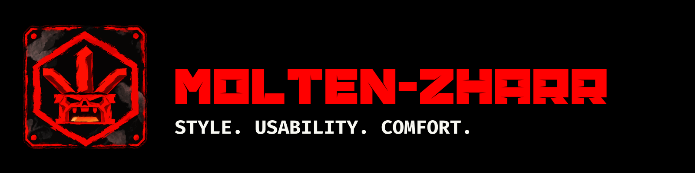
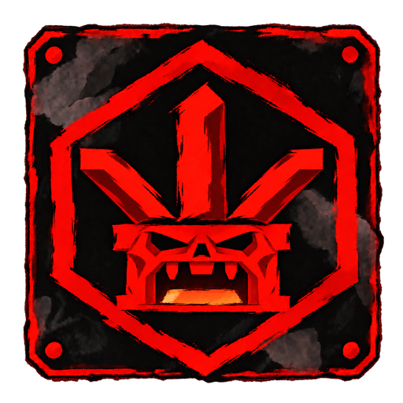

<!-- Publish the contents of this folder at the root of the public iamadahn/iamadahn repository. -->

[English](README.md) · [Русский](README.ru.md)

# Adahn The Imagined

Developer at [Molten-Zharr](https://github.com/molten-zharr).

  
  
  

## What I care about

  
  
  

I share the Molten-Zharr approach: beautiful software, guidance inside the application, and complete mouse and keyboard support, together or separately.

[Read our manifesto](manifesto/README.md).

