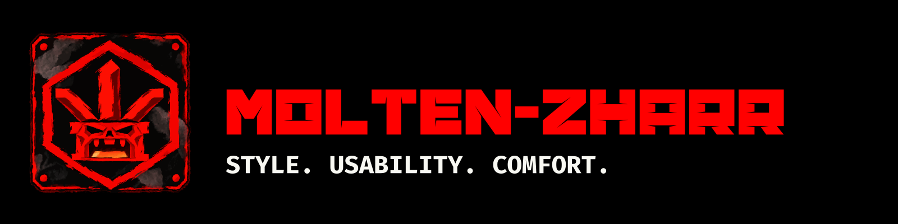
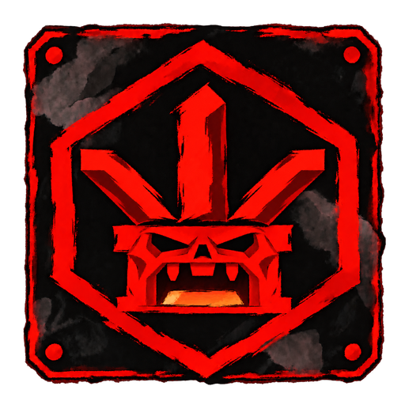

<!-- Разместите содержимое этой папки в корне публичного репозитория iamadahn/iamadahn. -->

[English](README.md) · [Русский](README.ru.md)

# Adahn The Imagined

Разработчик [Molten-Zharr](https://github.com/molten-zharr).

  
  
  

## Что для меня важно

  
  
  

Я разделяю подход Molten-Zharr: красивое ПО, помощь внутри программы и полноценное управление мышью и клавиатурой - вместе или по отдельности.

[Наш манифест](manifesto/README.ru.md).

